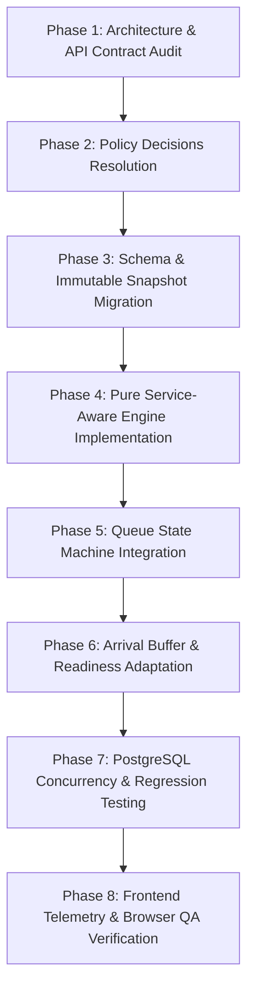

# Service-Aware Queue ETA and Recommended Arrival Time — Future Architecture Proposal

> **DOCUMENT STATUS:** PROPOSED — NOT APPROVED FOR IMPLEMENTATION  
> **Target Milestone:** Future Post-Redesign Development Phase  
> **Authority & Scope:** Non-executable architectural proposal and feasibility specification. This document does not authorize source code modifications, database migrations, runtime behavior changes, or alterations to existing canonical business rules. The immediate repository priority remains resolving the Booking Availability configuration failure, completing UI-1G-C, and finishing the frontend redesign.

---

## 1. Executive Summary & Problem Statement

### 1.1 The Operational Context
QueueTurn is a multi-tenant queue and appointment management platform operating under the tagline:  
**"Book a serial. Arrive smarter. Wait less."**

In QueueTurn, booking allocates an atomic, immutable daily serial number (`serial_number`) per provider per date. Customers do not book a guaranteed consultation start time; instead, they receive real-time, server-authoritative queue telemetry, including an estimated service start time (ETA) and a recommended arrival time.

### 1.2 The Current Baseline Limitation
Under the current Batch B architecture ([`backend/apps/queue/forecast.py`](file:///d:/SmartQueue/backend/apps/queue/forecast.py)), queue wait times are calculated using a single provider-wide planning baseline:
$$\text{Estimated Wait} = \text{Active Consultation Remaining} + (\text{Scheduled Predecessors Ahead} \times \text{Provider Average Duration})$$

Where:
- $\text{Scheduled Predecessors Ahead}$ is the integer count of preceding uncancelled waiting queue entries with $\text{serial\_number} < \text{current\_entry.serial\_number}$.
- $\text{Provider Average Duration}$ is the single uniform value resolved from `ProviderProfile.average_service_minutes` (governed by BR-020 / D04).

### 1.3 The Core Problem: Mixed Service Catalogs
In real-world healthcare, beauty, salon, professional consulting, and technical repair clinics, a single provider frequently offers a diverse catalog of services with dramatically different consultation and procedural durations.

For example, a specialist aesthetician or medical consultant may offer:
- **Service A (Quick Follow-up / Stitch Removal):** 15 minutes
- **Service B (General Consultation & Diagnostic):** 30 minutes
- **Service C (Comprehensive Treatment / Procedural Care):** 90 minutes

Under the current uniform multiplication model (assuming a provider average of 30 minutes):
- If the three customers ahead have booked Service A (15m), Service A (15m), and Service B (30m), the actual expected workload ahead is **60 minutes**. However, the current engine forecasts $3 \times 30 = \mathbf{90\text{ minutes}}$ (+30m error, causing premature arrival and excessive physical waiting room congestion).
- Conversely, if the two customers ahead have booked Service C (90m) and Service C (90m), the actual expected workload ahead is **180 minutes**. The current engine forecasts $2 \times 30 = \mathbf{60\text{ minutes}}$ (-120m error, causing the customer to arrive 2 hours too early or panic due to perceived stall).

### 1.4 The Goal of This Proposal
To transition QueueTurn’s live operational telemetry from a **homogeneous serial-count multiplier** to a **heterogeneous service-aware workload summation**, while strictly preserving daily capacity integrity, atomic serial allocation, presence-gated calling, and tenant security boundaries.

---

## 2. Existing Behavior vs. Proposed Architecture

| Dimension | Current Baseline (Batch B / M2) | Proposed Future Milestone (Service-Aware) |
|---|---|---|
| **Predecessor Workload Calculation** | Multiplies count of preceding waiting entries by `provider.average_service_minutes` ($\text{Count} \times \bar{D}$). | Sums the expected duration of each individual service booked by predecessors ($\sum_{i \in \text{Preceding}} D_i$). |
| **Provider Average Role** | Sole driver for both daily booking capacity and live queue forecast. | Retained as the authoritative driver for **daily booking capacity**; serves as fallback only when an individual appointment duration is unspecified. |
| **Active Service Overrun** | When elapsed consultation time exceeds expected duration ($t_{\text{elapsed}} \ge D$), remaining time collapses to `0`. | Implements an overrun buffer/decay model so that an ongoing service does not falsely treat the provider as immediately free. |
| **Appointment Duration Snapshot** | `Appointment` stores FK to `Service` and `start_datetime`/`end_datetime`, but lacks an immutable booked duration field. | Introduces an explicit, immutable `booked_duration_minutes` snapshot upon booking creation to prevent retroactive catalog edits from corrupting active queues. |
| **Readiness Guidance** | Evaluated against current uniform ETA minus organization buffer. | Evaluated against high-precision service-aware ETA minus organization buffer. |
| **Recommended Arrival** | Calculated as $\text{ETA} - \text{buffer}$ (with 5-minute exception for the day's first serial). | Calculated as $\text{Service-Aware ETA} - \text{buffer}$ (preserving the 5-minute first-serial rule). |

---

## 3. Detailed Component Architecture

### 3.1 Multiple Services Per Provider (Catalog Flexibility)
- A provider profile (`ProviderProfile`) may be linked to multiple services via `ProviderService`.
- Each service in `Service` defines a default `duration_minutes` (positive integer).
- Each assignment in `ProviderService` may optionally define a provider-specific `custom_duration_minutes`.
- **Policy Invariant:** No artificial constraint will be imposed restricting providers to a single service or forcing catalog services to share similar durations.

### 3.2 Preservation of Provider-Level Average for Capacity Planning
- The existing provider-level `average_service_minutes` and the validation rules established in **BR-020, BR-029, BR-048, and Decision D04** will remain authoritative for:
  1. Provider onboarding validation.
  2. Daily capacity budget allocation: $\text{Budget} = \lfloor \text{Effective Working Minutes} / \text{average\_service\_minutes} \rfloor$.
  3. Schedule change approvals and break/leave collision testing.
- The service-aware ETA enhancement applies strictly to **real-time queue telemetry and arrival forecasting**, leaving the daily booking capacity algorithm uncoupled and intact.

### 3.3 Service-Aware Live Queue Workload Summation
For a given customer's queue entry $E$ with serial number $S_E$ on business date $T$:

1. Identify all active and eligible predecessor entries in the same provider queue:
   $$\mathcal{P}_E = \{ P \in \text{QueueEntry} \mid P.\text{provider} = E.\text{provider}, P.\text{queue\_date} = T, P.\text{status} = \text{'WAITING'}, P.\text{serial\_number} < S_E \}$$
2. For each predecessor $P \in \mathcal{P}_E$, resolve their expected duration $D(P)$:
   - Primary: Immutable snapshot `P.appointment.booked_duration_minutes`.
   - Secondary Fallback: Assignment `ProviderService.custom_duration_minutes`.
   - Tertiary Fallback: Catalog `Service.duration_minutes`.
   - Quaternary Fallback: Provider average `ProviderProfile.average_service_minutes`.
3. Calculate the aggregate waiting workload:
   $$W_{\text{waiting}} = \sum_{P \in \mathcal{P}_E} D(P)$$

### 3.4 In-Progress Consultation & Overrun Telemetry
When a provider is currently serving an active entry $A$ ($\text{status} = \text{'IN\_PROGRESS'}$):
- Let $t_{\text{start}} = A.\text{started\_at}$.
- Let $t_{\text{elapsed}} = \text{now} - t_{\text{start}}$ (in minutes).
- Let $D(A)$ be the expected duration of active appointment $A$.

#### The Overrun Dilemma
In medical and service practices, consultations frequently exceed estimated times. The current code sets $\text{active\_remaining} = \max(0, D - t_{\text{elapsed}})$, which abruptly drops to $0$ once $t_{\text{elapsed}} \ge D$. This produces a false signal that the provider is idle and ready for the next customer.

#### Proposed Overrun Resolution:
- If $t_{\text{elapsed}} < D(A)$:
  $$\text{Remaining}(A) = D(A) - t_{\text{elapsed}}$$
- If $t_{\text{elapsed}} \ge D(A)$ (Consultation Overrun):
  Do not collapse to zero. Instead, apply an exponential decay or standard grace extension:
  $$\text{Remaining}(A) = \text{GraceBuffer} \times e^{-\lambda (t_{\text{elapsed}} - D(A))} \quad \text{or a decaying step floor (e.g. 5 minutes)}$$
  Simultaneously flag `is_delayed = True` and emit informative status text: *"Current consultation running longer than expected. Estimates are actively adjusting."*

### 3.5 Queue Eligibility, Presence Gating & Ordering Invariants
The proposed calculation must strictly honor all non-negotiable state machine rules ([`docs/QUEUE_STATE_MACHINE.md`](file:///d:/SmartQueue/docs/QUEUE_STATE_MACHINE.md)):
1. **Presence-Gated Call Next:** Staff can only call entries that have physically checked in ($\text{is\_checked\_in} = \text{True}$).
2. **Serial Priority:** Calling order among checked-in customers is strictly ascending by `serial_number`. No urgent, VIP, or appointment-time priority overrides exist.
3. **No Consultation Interruption:** Calling or starting next service cannot preempt an active consultation.
4. **Skip and Restore:** A skipped entry transitions to `SKIPPED` (appointment `NO_SHOW`). When restored by authorized staff, it re-enters as `WAITING` with its **original serial number**. Once restored, its service duration naturally re-enters the active predecessor workload summation $\mathcal{P}_E$.

### 3.6 Recommended Arrival Time & Buffer Coupling
- Preserves the owner-approved organization arrival buffer policy (**BR-049 / BR-050 / Decision D07**): `Organization.arrival_buffer_minutes` configured to exactly 15, 20, 25, or 30 minutes.
- **First Serial Rule:** The earliest effective booking of the day targets arrival at $\text{Scheduled Start} - 5\text{ minutes}$.
- **Subsequent Serials:**
  $$\text{Recommended Arrival} = \text{Service-Aware ETA} - \text{arrival\_buffer\_minutes}$$
- **Readiness State Thresholds (Time-First):**
  - $\Delta t = \text{Service-Aware ETA} - \text{now}$
  - If $\Delta t > \text{buffer} + 10\text{ min} \implies \text{NOT\_YET}$
  - If $\text{buffer} < \Delta t \le \text{buffer} + 10\text{ min} \implies \text{GET\_READY}$
  - If $\Delta t \le \text{buffer} \implies \text{BE\_READY}$
  - If actually called $\implies \text{TURN\_NOW}$

### 3.7 Immutable Duration Snapshotting
- **The Vulnerability:** If a clinic manager modifies a service duration in the catalog (e.g., changing "Full Diagnostic" from 45 min to 60 min), any active, scheduled appointments booked prior to the change would experience retroactive ETA shifts.
- **The Architectural Requirement:** Follow the proven design pattern established by `Appointment.booked_service_charge` (BR-025). When an appointment is booked, persist an immutable snapshot field:
  ```python
  booked_duration_minutes = models.PositiveIntegerField(null=True, blank=True)
  ```
- **Legacy Records:** Pre-existing historical appointments will have `booked_duration_minutes = None`. The calculation engine will resolve their duration dynamically through `ProviderService.custom_duration_minutes` or catalog `Service.duration_minutes` without fabricating historical database facts.

---

## 4. Unresolved Policy Decisions Requiring Owner Approval

Before this architecture can be scheduled for implementation, the project owner must resolve the following open policy questions:

### Decision Open-1: Treatment of Unchecked-In Predecessors in ETA Calculation
- **Context:** At 10:00 AM, Serial #5 (checked in) is waiting. Preceding entries are Serial #2 (checked in), Serial #3 (not checked in), and Serial #4 (not checked in).
- **Option A (Conservative Reservation Forecast — Current Contract):** Include Serials #2, #3, and #4 in the workload sum. Assumes all booked customers may arrive within their arrival window.
- **Option B (Presence-Only Real-Time Forecast):** Include only Serial #2 and Serial #5. If Serial #3 arrives later, the ETA dynamically shifts backward.
- **Option C (Decayed / Windowed Reservation Forecast):** Include unchecked reservations until their recommended arrival window has expired by more than $K$ minutes, after which their workload is discounted or marked provisional.
- *Status:* **OPEN — Pending Owner Decision.**

### Decision Open-2: Overrun Damping Formulation
- When an active consultation exceeds its expected service duration, which mathematical damping formula should govern `remaining_service_minutes`?
  - Fixed residual floor (e.g., hold at 5 minutes until completed)?
  - Dynamic linear step-down?
- *Status:* **OPEN — Pending Owner Decision.**

---

## 5. Non-Negotiable Preserved Business Invariants

Any future implementation of this proposal must strictly maintain:
1. **Asia/Dhaka Time Authority (BR-017 / F-017):** Calendar business dates and time boundaries are strictly computed in `Asia/Dhaka` (`UTC+6`).
2. **Rolling 3-Day Horizon (BR-001):** Bookings are allowed only for today and the next three calendar days.
3. **Atomic Serial Integrity (BR-002):** Serials are allocated monotonically via atomic provider-locked counters; cancelled serials are never reused.
4. **Midnight Queue Continuation (BR-012):** Active consultations across midnight remain valid; normal operating days maintain the obligation to complete booked serials.
5. **Presence-Gated Call Next (BR-007):** Physical presence check-in is mandatory before a token can be called.
6. **No VIP/Urgent Priority (BR-008):** Ascending serial order is immutable; no priority flag can bypass queue ordering.
7. **Tenant Isolation:** No provider schedule, duration snapshot, or queue telemetry may leak across organizational boundaries.

---

## 6. Phased Implementation Roadmap

When authorized by the project owner in a future milestone, the transition will follow eight controlled phases:



### Phase Breakdown:
1. **Phase 1: Contract Audit:** Audit all consumers of `calculate_readiness_and_eta` across customer, provider, and staff surfaces.
2. **Phase 2: Owner Policy Approval:** Resolve Decisions Open-1 and Open-2.
3. **Phase 3: Snapshot Persistence:** Introduce nullable `booked_duration_minutes` to `Appointment` with non-destructive forward migration.
4. **Phase 4: Calculation Engine:** Implement `calculate_service_aware_workload()` in `apps/queue/forecast.py` with pure unit tests.
5. **Phase 5: State Machine Integration:** Hook new workload calculation into `start_queue_entry`, `complete_queue_entry`, and `skip_queue_entry`.
6. **Phase 6: Arrival & Readiness Integration:** Integrate buffer offsets and calibrate `GET_READY` / `BE_READY` thresholds.
7. **Phase 7: Regression & Concurrency Tests:** Run comprehensive test suite asserting that existing capacity limits, booking horizons, and emergency recovery remain unaffected.
8. **Phase 8: Frontend Telemetry & Browser QA:** Verify customer dashboard live queue card counter updates and telemetry polling reflow in the browser.

---

## 7. Edge Case Evaluation Matrix

| Edge Case Scenario | Expected Service-Aware Engine Behavior |
|---|---|
| **Mixed Catalog Queue** | Workloads ahead are summed individually per booked service ($15 + 90 + 30 = 135\text{m}$) rather than multiplied by uniform average ($3 \times 30 = 90\text{m}$). |
| **Consultation Overrun ($t_{\text{elapsed}} > D$)** | Provider remains marked `IN_PROGRESS`; remaining duration does not collapse to 0; `is_delayed = True` is broadcast with an explanatory note. |
| **Skipped Entry Restored** | When staff restores a skipped entry, its original serial and booked duration re-insert into the predecessor sum $\mathcal{P}_E$ in proper chronological position. |
| **Catalog Duration Modified Post-Booking** | Existing booked appointments evaluate against their immutable `booked_duration_minutes` snapshot; active queues remain stable. |
| **Emergency Temporary Incident** | Emergency hold immediately supersedes all timing telemetry; displays standard emergency interruption status without exposing internal notes. |
| **Midnight Queue Crossing** | Active consultation continues seamlessly across midnight; previous-day queue retains original date and actual duration telemetry. |
| **Unconfigured Provider Duration** | If a provider has no explicit average and mixed services, booking remains blocked per BR-020; the queue engine reports timing unavailable rather than guessing. |

---

## 8. Conclusion and Next Steps

This document establishes the authoritative technical blueprint for **Service-Aware Queue ETA and Recommended Arrival Time**. 

- **Current Status:** Awaiting future prioritization and explicit owner authorization.
- **Immediate Focus:** Complete the current UI-1G-C browser smoke audit and resolve the customer booking availability failure.
