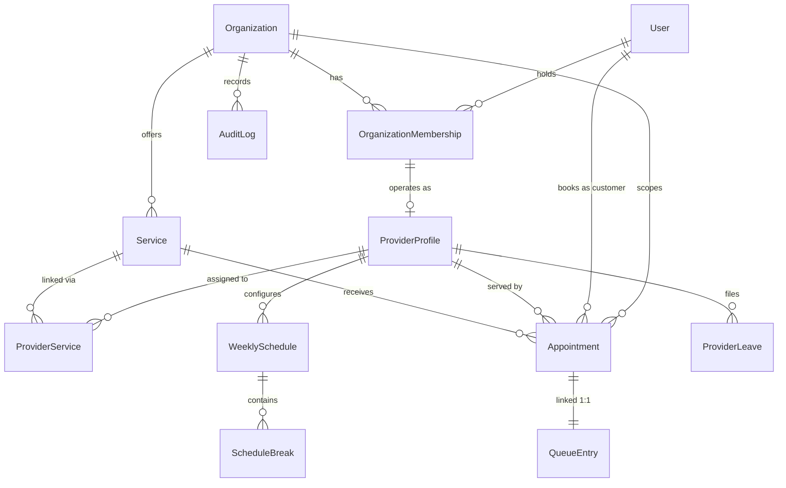

# QueueTurn — Master Project Knowledge Handoff & Technical Continuation Reference

> **Authoritative Baseline:** Post-UI-1G-C Verified System State  
> **Repository:** `d:\SmartQueue`  
> **Git Branch:** `main`  
> **Git Working Tree State:** Baseline was clean prior to documentation work; currently contains 3 modified tracked documentation files (`docs/QueueTurn_UI_REDESIGN_MASTER_PLAN.md`, `docs/UI_DESIGN_SYSTEM.md`, `docs/UI_REDESIGN_PLAYBOOK.md`) and 3 untracked new Markdown files in `docs/handoffs/` pending human owner review and commit.  
> **Date:** October 17, 2026 (Asia/Dhaka)  
> **Status:** Canonical Master Handoff for Development Continuity  

---

## 1. Executive Overview & Project Identity

### 1.1 Purpose & Tagline
**QueueTurn** (formerly SmartQueue) is an enterprise multi-tenant appointment scheduling and real-time queue management platform.  
**Tagline:** *"Book a serial. Arrive smarter. Wait less."*

### 1.2 Core Product Differentiators
Traditional scheduling systems force customers to select a rigid, guaranteed start-time slot (e.g., "10:15 AM – 10:45 AM"). In healthcare, specialist consulting, high-end beauty, and technical repair, consultations routinely overrun or complete early, rendering rigid slots inaccurate and congesting physical waiting rooms.

QueueTurn replaces guaranteed time slots with an **atomic, date-based serial reservation** coupled with **server-authoritative live queue telemetry**:
1. Customers reserve a daily serial number (`serial_number`) for a specific service professional on a specific date.
2. The server dynamically calculates an estimated service start time (ETA), recommended arrival window, and advisory readiness state (`NOT_YET`, `GET_READY`, `BE_READY`, `TURN_NOW`, `IN_SERVICE`).
3. Physical calling requires verified physical check-in (`is_checked_in = True`). Absent or un-checked-in reservations can never be called.
4. Calling follows strictly ascending serial order among checked-in customers; priority overrides, VIP jumping, and channel-based favoritism are strictly prohibited.

---

## 2. Technology Stack & System Architecture

### 2.1 Backend Architecture
- **Language & Runtime:** Python 3.14.5 (64-bit AMD64).
- **Core Framework:** Django 6.1.1, Django Rest Framework (DRF) 3.18.1.
- **Database:** PostgreSQL (production & development, `smartqueue_db`), with atomic transaction isolation and row-level locking (`select_for_update`). Test configuration defaults to isolated in-memory SQLite under pytest (`--nomigrations`).
- **Asynchronous & Real-time:** Django Channels, ASGI/WSGI entry points in `backend/config/`.
- **Application Modules (`backend/apps/`):**
  - `accounts`: User model (`accounts.User`), authentication (JWT via SimpleJWT), audit logging (`apps.audit.models.AuditLog`).
  - `organizations`: Organization profiles (`Organization`), document metadata (`OrganizationDocument`), tenant memberships (`OrganizationMembership`), operating hours (`OrganizationOperatingHours`), trust badges (`smartqueue_verified`).
  - `providers`: Professional profiles (`ProviderProfile`), provider-service catalog assignments (`ProviderService`), weekly schedules (`WeeklySchedule`), schedule breaks (`ScheduleBreak`), leaves (`ProviderLeave`), schedule change requests (`ScheduleChangeRequest`), pricing resolution (`pricing.py`).
  - `services`: Categories (`Category`), service catalog (`Service`), duration definitions, base charges.
  - `appointments`: Booking domain services (`AppointmentService`, `AppointmentAvailabilityService`), serial allocation (`serials.py`, `ProviderDateSerial`), booking policy constraints (`booking_policy.py`), contact normalization (`contacts.py`), customer cancellation/rescheduling.
  - `queue`: Queue entry model (`QueueEntry`), queue state machine & transitions (`QueueService`), forecast and readiness calculation (`forecast.py`), Call Next dispatcher.
  - `feedback`: Customer reviews (`Review`) and rating aggregations.
  - `notifications`: In-app notification creation, recipient ownership, polling delivery (`NotificationService`, `Notification`).
  - `contact`: Public inquiries (`ContactMessage`), issue reports (`AppointmentIssueReport`), email integration (`email_service.py`).
  - `audit`: Immutable system audit ledger (`AuditLog`).

### 2.2 Frontend Architecture
- **Framework & Tooling:** React 19.2.8, Vite 8.3.0, React Router DOM 7.18.3.
- **Linter & Utilities:** Oxlint 1.81.0, Axios 1.20.0.
- **Styling:** Modular CSS architecture adhering to the UI Design System:
  - Global base tokens and light/dark theme variables (`src/styles/index.css`).
  - Protected landing page styling (`src/styles/LandingPage.css`, `LandingNavbar.css`).
  - Operational AppShell styling (`src/styles/AppShell.css`).
  - Operational shared primitives (`src/styles/OperationalPrimitives.css`).
  - Component-specific scoped stylesheets.
- **Context Providers (`src/contexts/`):**
  - `AuthContext.jsx`: User identity, JWT session storage (`sq_access_token`, `sq_refresh_token`), login/logout, unauthorized event bus (`sq:auth:unauthorized`).
  - `TenantContext.jsx`: Selected active organization (`sq_selected_org_id`), role resolution.
  - `ThemeContext.jsx`: Persisted warm-sand/navy theme preference (`smartqueue_theme`).
- **Service Layer (`src/services/`):**
  - `api.js`: Axios client with interceptors for JWT injection and token refresh.
  - Domain services for appointments, queue, organizations, services, and notifications.
- **Route Architecture (`src/routes/AppRoutes.jsx`):**
  - 77 identified route patterns categorized into Public/Discovery, Auth/Onboarding, Customer, Provider, Staff, Manager, Admin, and Aliases.
  - Protected operational routes compose `AppShell.jsx` directly; public pages compose `PublicNavbar.jsx`.

---

## 3. Core Domain Models & Entity Relationships

The diagram below reflects the **actual Django model classes** declared in the codebase:

### Clarifications on Domain Entities:
1. **Customer Identity:** There is no separate `Customer` model table. A customer is simply an authenticated global `accounts.User` record, linked via foreign key `Appointment.customer -> User`.
2. **Organization Membership:** Represented by `organizations.OrganizationMembership` (with roles: `OWNER`, `MANAGER`, `STAFF`, `PROVIDER`).
3. **QueueEntry 1:1 Link:** `QueueEntry.appointment` is a strict `OneToOneField` to `Appointment`.
4. **Serial High-Water Mark:** Tracked per `(provider, date)` via `appointments.ProviderDateSerial`.
5. **Snapshots on Appointment:**
   - `booked_service_charge` (Decimal 10,2): Server-authoritative charge snapshot at booking time.
   - `contact_name` (max 300) & `contact_phone` (max 30): Appointment-specific snapshot; does not alter customer user profile.

---

## 4. Reconciled Authoritative Business Rules Register

All rule identifiers match the canonical register in [`docs/BUSINESS_RULES.md`](file:///d:/SmartQueue/docs/BUSINESS_RULES.md):

| Canonical Rule ID | Domain | Specification & Distinctions | Implementation Location | Evidence Status |
|---|---|---|---|---|
| **BR-001** | Identity | Customers are global `User` accounts; operational membership is tenant-scoped via `OrganizationMembership`. | `apps/accounts/models.py` | `[VERIFIED - S]` |
| **BR-004** | Privacy | Discovery endpoints strictly exclude private documents, reviewer emails, and internal notes. | `apps/organizations/serializers.py`, `apps/providers/serializers.py` | `[VERIFIED - M1]` |
| **BR-012** | Pricing | Customer charge resolved via centralized pricing abstraction; valid 0.00 charge preserved. | `apps/providers/pricing.py` | `[VERIFIED - S]` |
| **BR-016** | Schedules | Weekly provider schedules define working days; schedule changes require manager approval. | `apps/providers/schedule_changes.py` | `[VERIFIED - M2]` |
| **BR-017** | Capacity | Configured break intervals reduce daily usable working minutes. | `apps/appointments/services.py:278-325` | `[VERIFIED - S]` |
| **BR-020** | Duration | Effective service duration prioritizes `ProviderService.custom_duration_minutes` over base `Service.duration_minutes`. | `apps/appointments/services.py:75-89` | `[VERIFIED - S]` |
| **BR-022** | Timezone | All operational dates, capacity budgets, and shift windows use project-local `Asia/Dhaka` (`UTC+06:00`). | `apps/appointments/booking_policy.py` | `[VERIFIED - M2]` |
| **BR-023** | Booking Window | Rolling 4-calendar-day booking horizon (`today` through `today + 3`). | `apps/appointments/booking_policy.py` | `[VERIFIED - M2]` |
| **BR-024** | Atomic Booking | Booking coordinates `provider` lock first, then assignment lock; creates linked Appointment & QueueEntry atomically. | `apps/appointments/services.py:488-704` | `[VERIFIED - M2]` |
| **BR-025** | Price Snapshot | Stored `booked_service_charge` is server-authoritative and immutable once booked. | `apps/appointments/services.py:530` | `[VERIFIED - S]` |
| **BR-030** | Serial Non-Reuse | Serials belong to `(provider, date)` and increment permanently. Cancelled serials are NEVER reused. | `apps/appointments/serials.py` | `[VERIFIED - M2]` |
| **BR-034** | Channels | `ONLINE`, `PHONE`, and `FRONT_DESK` bookings share identical queue entry semantics and serial counters. | `apps/appointments/services.py` | `[VERIFIED - M2]` |
| **BR-035** | Check-In | Check-in requires matching current `Asia/Dhaka` business date (`appointment_date == today`). | `apps/queue/services.py:128-219` | `[VERIFIED - S]` |
| **BR-037** | Presence Gating | Call Next is strictly presence-gated: only eligible checked-in (`is_checked_in = True`) WAITING entries can be called. | `apps/queue/services.py:287-310` | `[VERIFIED - S]` |
| **BR-038** | Queue Order | Calling uses ascending serial order among eligible checked-in customers. No VIP or channel priority. | `apps/queue/services.py:295` | `[VERIFIED - M2]` |
| **BR-041** | Start Consultation | Starting consultation synchronizes `QueueEntry -> IN_PROGRESS` and `Appointment -> IN_PROGRESS`. | `apps/queue/services.py:700` | `[VERIFIED - S]` |
| **BR-042** | Completion | Completing consultation synchronizes both models to `COMPLETED`. | `apps/queue/services.py:740` | `[VERIFIED - S]` |
| **BR-043** | Skip & Restore | Skipping marks entry `SKIPPED` and appointment `NO_SHOW`. Staff can restore to original serial/date. | `apps/queue/services.py:780-840` | `[VERIFIED - M2]` |
| **BR-044** | Cancellation | **Customer Self-Cancellation:** Allowed only until at least 2 hours before the provider's scheduled shift start on the appointment date, while `WAITING`. **Operational Cancellation:** Authorized managers/staff/admins can cancel WAITING bookings operationally without the 2-hour customer cutoff. | `apps/appointments/services.py:760-778` | `[VERIFIED - S/R]` |
| **BR-005 / Lifecycle** | Rescheduling | **Customer Self-Rescheduling:** Allowed only while QueueEntry is `WAITING` and the authoritative estimated service start is at least 90 minutes after current time. | `apps/appointments/services.py:660-676` | `[VERIFIED - S]` |
| **BR-045** | Midnight Policy | Midnight does not auto-cancel, auto-skip, or expire bookings. Consultations can cross midnight. | `apps/queue/services.py` | `[VERIFIED - M2]` |
| **BR-049** | Readiness | Stored model choice and computed dynamic tokens: `NOT_YET`, `GET_READY`, `BE_READY`, `TURN_NOW`, `IN_SERVICE`. | `apps/queue/models.py:21-27` | `[VERIFIED - S]` |
| **BR-062** | Legacy Identifiers| Protected compatibility keys (`smartqueue_db`, `smartqueue_theme`, `sq_*`, `sq-*` CSS) must NOT be renamed. | Repository-wide | `[VERIFIED - S]` |

---

## 5. Readiness States: Persisted Field vs. Dynamic Live Forecast

### 5.1 Persisted Field vs. Computed Telemetry
QueueTurn maintains a precise distinction regarding readiness:

1. **Persisted Database Column (`QueueEntry.readiness_state`):**
   - Declared on `QueueEntry` as `models.CharField(max_length=20, choices=ReadinessState.choices, default=ReadinessState.NOT_YET)`.
   - Stores the default status or persisted checkpoint.
2. **Dynamic Live Forecast (`apps.queue.forecast.calculate(entry)`):**
   - The authoritative readiness value returned to customers and staff via API is **ephemeral and dynamically calculated on read**.
   - It is derived on-the-fly from the current clock, provider operational activity, preceding checked-in serials, and active consultation elapsed minutes.
   - The database column is NOT mutated on every clock second or predecessor progression.

### 5.2 Authoritative Readiness Tokens
- `NOT_YET`: Far from turn or booking is on a future date.
- `GET_READY`: Within advisory preparation threshold (estimated start within buffer window).
- `BE_READY`: Next in line or within urgent arrival threshold.
- `TURN_NOW`: Provider has called this specific customer (`QueueEntry.status == CALLED`).  
  *(Note: The token is strictly `TURN_NOW`. `PROCEED_NOW` was a historical misnomer and does not exist in source).*
- `IN_SERVICE`: Provider has begun consultation (`QueueEntry.status == IN_PROGRESS`).

---

## 6. Service-Aware ETA Architecture Proposal

> **DOCUMENT STATUS:** PROPOSED — NOT APPROVED FOR IMPLEMENTATION  
> **Reference File:** `docs/SERVICE_AWARE_ETA_FUTURE_PROPOSAL.md` (Git commit `c15bfaf`)

### 6.1 Motivation
In clinics offering mixed service durations (e.g., 15-minute quick checkup vs. 90-minute procedural repair), multiplying predecessor count by a uniform provider average creates forecasting drift (+30m to -120m).

### 6.2 Proposed Design
- Workload summation: $\sum_{P \in \text{Preceding}} D(P)$.
- Snapshot immutable `booked_duration_minutes` on `Appointment` at booking time.
- Overrun decay buffer so consultations exceeding expected duration do not falsely report 0 minutes remaining.
- Retain `ProviderProfile.average_service_minutes` for daily capacity budget allocation.

---

## 7. Recent Booking Availability Fix (`PROVIDER_AVERAGE_SERVICE_TIME_REQUIRED`)

- **Commit:** `23c0683ab17c2d12eeb1a3183de10af489184093`
- **Issue:** Booking availability API failed with validation error `PROVIDER_AVERAGE_SERVICE_TIME_REQUIRED` when attempting to fetch slots for providers in demo data whose `average_service_minutes` was `0` or null.
- **Resolution:**
  1. Remediated zero duration in `seed_demo_data.py` and `demo_enrichment.py` while preserving existing configured provider values.
  2. Enhanced frontend error handling in `BookAppointmentPage.jsx` and added `availabilityDisplay.js`.
  3. Added 318 lines of regression tests (`backend/apps/appointments/tests/test_provider_availability_duration.py`) and 98 lines of frontend unit tests.

---

## 8. UI Redesign Design System & Standards

### 8.1 Visual Foundation (Approved Landing Page DNA)
The QueueTurn landing page (`LandingPage.jsx`) serves as the authoritative visual reference:

| Element | Light Theme (Warm Sand / Espresso) | Dark Theme (Navy / Deep Teal) | Functional Purpose |
|---|---|---|---|
| **Canvas** | `#FAF8F3` (warm sand) | `#0B1220` (deep navy) | Primary application background |
| **Surface** | `#FFFFFF` (crisp white) | `#151F2D` (elevated slate) | Operational cards, tables, panels |
| **Primary Text** | `#211C19` (espresso) | `#F3F6F5` (off-white) | High-contrast body & headings |
| **Secondary Text**| `#57534E` (stone) | `#C7D2D0` (slate teal) | Metadata, timestamps, captions |
| **Primary CTA** | `#2F2520` (deep espresso) | `#2A9D8F` (vibrant teal) | Primary action buttons |
| **Accent / Tone** | `#5F7A70` (sage) | `#6F9187` (sage) | Supporting badges, active tabs |
| **Border** | `#E6E1D9` (warm gray) | `#2A394B` (navy border) | Subtle dividers and card outlines |

### 8.2 Operational AppShell (`AppShell.jsx`)
- Composed directly by protected route groups in `AppRoutes.jsx`.
- Features accessible SVG navigation rails, responsive mobile drawer (hamburger menu), tenant switcher, notifications bell, and theme toggle.
- Strictly isolated from public landing navbar (`PublicNavbar.jsx`).

### 8.3 Refined Operational Layout Philosophy vs. Repetitive Card Boxes (Owner Approved 2026-10-17)
The refined QueueTurn landing page (`LandingPage.jsx`) provides the authoritative visual personality, but operational pages must **not** replicate its card-heavy or box-heavy composition everywhere:
- **Open, Breathable Layouts:** Prefer thoughtful whitespace, subtle hairline dividers (`--color-border`), typographic hierarchy, and background tonal transitions (`--color-bg` vs `--color-bg-subtle`).
- **Selective Framing:** Apply cards, borders, and shadows selectively—only when containment directly improves semantic grouping or interaction clarity. Avoid wrapping every heading, metric, table, action, or informational block in a rectangular container.
- **Selective & Purposeful Motion:**
  - *Permitted:* Sidebar/drawer transitions, button hover/focus rings (`:focus-visible`), modal entrances, subtle section reveals, restrained telemetry/chart transitions, and accessible loading skeletons.
  - *Forbidden:* Excessive scroll-triggered animations, repeated entrance animations on data polling refreshes, animated operational controls that cause layout shifts or delay clicks, and decorative animations on every table row or card.
  - *Compliance:* Strict support for `@media (prefers-reduced-motion: reduce)`.

### 8.4 Role-Specific Layout Density
- **Customer:** Calm, approachable, minimal. Emphasize booking CTA, upcoming appointment cards, and clear live queue guidance.
- **Staff:** Efficient operational layout with scan-friendly lists, prominent presence toggles, and rapid access to check-in/call controls.
- **Provider:** Focused operational view prioritizing the current active consultation, next eligible serial, daily workload, and queue state triggers.
- **Organization Manager:** Analytical and governance overview, operational insights, appointment volume trends, staff oversight, and capacity management.
- **Platform Admin:** High-density platform management, audit-ready data tables, organization approvals, and platform health metrics.

---

## 9. Completed UI Redesign Milestones Ledger

| Milestone | Scope & Components | Commit Hash | Acceptance Status | Verification Evidence |
|---|---|---|---|---|
| **UI-0** | Route, shell, and CSS inventory | — | ACCEPTED | Read-only audit of 77 routes and stylesheets. |
| **UI-1A** | Operational AppShell & responsive drawer | `d916447` | ACCEPTED | Build/lint pass; AppShell responsive across breakpoints. |
| **UI-1B** | Shared Operational Primitives (`StatCard`, `StatusBadge`, CSS) | `8b80373` | ACCEPTED | Token-aware metrics cards and status badges verified. |
| **UI-1C** | Staff Dashboard visual redesign | `9b3ca49` | ACCEPTED | Preserved queue metrics, presence toggles, and tenant scope. |
| **UI-1D** | Provider Dashboard visual redesign | `41a6099` | ACCEPTED | Daily workload, active call banner, and schedule status. |
| **UI-1E** | Manager Dashboard visual redesign | `18c5dad` | ACCEPTED | Tenant analytics, staff roster, capacity oversight. |
| **UI-1F** | Admin Dashboard visual redesign | `2fcd385` | ACCEPTED | Platform-wide metrics, tenant management, inbox view. |
| **UI-1G-A** | Customer Dashboard shell redesign | `8bca8ff` | ACCEPTED | Welcome greeter, telemetry metrics, empty states. |
| **UI-1G-B** | Customer Booking Card redesign (`CustomerBookingCard.jsx`) | `44e11fc` | ACCEPTED | Component layout, responsive styling, action buttons. |
| **UI-1G-C** | Authenticated Populated Customer Dashboard QA | *(Verified Live)* | **PASSED** | Live browser QA in 390px, 768px, 1024px, 1440px; Light & Dark themes verified (see details below); full fixture teardown. |

---

## 10. QA Fixture Lifecycles & Browser Evidence Details

### 10.1 UI-1G-C Browser QA Artifacts Breakdown
- **Customer Account:** `customer.demo@example.com` (`Sadia Rahman`).
- **Temporary Booking:** `ac263254-5b8c-4620-b5e0-9f608c6b01d0` (Date: `2026-10-17`, Serial `#1`).
- **Captured Screenshot Evidence in Brain Artifact Directory:**
  - `customer_card_1440_light` (1440x900 Desktop Light Theme) — `[VERIFIED - R]`
  - `customer_card_1024_light` (1024x768 Small Desktop Light Theme) — `[VERIFIED - R]`
  - `customer_card_768_light` (768x1024 Tablet Light Theme) — `[VERIFIED - R]`
  - `customer_card_390_light` (390x844 Mobile Light Theme) — `[VERIFIED - R]`
  - `customer_card_1440_dark` (1440x900 Desktop Dark Theme) — `[VERIFIED - R]`
  - `customer_card_390_dark` (390x844 Mobile Dark Theme) — `[VERIFIED - R]`
- **Unverified Combinations:** Dark theme standalone PNG screenshots for 768px and 1024px were not captured during the subagent session (desktop and mobile dark boundaries were verified).
- **Explicit Non-Regression:** Physical arrival check-in and `CustomerLiveQueuePage` calling were **NOT** exercised during this card verification, adhering strictly to non-negotiable queue invariants.

### 10.2 Fixture Teardowns & Current Database State
1. **Authorized UI-1G-C Fixture (`ac263254-5b8c-4620-b5e0-9f608c6b01d0`):**
   - Cancelled immediately via customer self-cancellation API (`POST .../cancel/`) with reason: `"Temporary UI-1G-C populated dashboard QA fixture cleanup"`.
   - Verified `Appointment.status == CANCELLED`, `QueueEntry.status == CANCELLED`, serial `#1` preserved, `AuditLog` recorded.
2. **Prior Unintended QA Fixture (`d6a4d317-c2f8-44fc-9574-d9452e820406`):**
   - Cancelled via authorized manager operational cancellation API (`Imran Hossain`).
   - Verified `CANCELLED`, serial preserved. Closed permanently. Do not touch.
3. Total appointments in database: 106. Zero active test fixtures remain.

---

## 11. Remaining Issues, Open Findings & Unresolved Decisions

### 11.1 Open Findings Register
- **F-013 (P2):** Shared-phone identity resolution during front-desk/phone walk-in registration.
- **F-017 (P2):** Browser business-date mismatch on cross-midnight and foreign client timezone displays.
- **F-021 (P2):** Contact form & password reset email send outcome discarded; delivery failure not visible to operator.
- **F-024 (P1 / High):** Private document direct storage serving production authorization and cutover verification.
- **F-025 (P3 / Low):** Role-dependent OpenAPI response schema mismatch in Swagger documentation.

### 11.2 Key Pending Decisions (D01–D20)
- **D01 / D02:** Capacity budget basis (total day vs. remaining usable day; partial leave interval deduction).
- **D04:** Historical duration basis and immutable duration snapshot.
- **D09:** Customer identity matching policy for phone walk-ins.
- **D11:** Reschedule pricing policy (preserve booked snapshot vs. reprice to current catalog).
- **D13:** Email delivery outcome semantics (`REPLIED` saved before send).
- **D14:** Server-side idempotency key for booking requests.

### 11.3 Organization Manager Dashboard — Real Dynamic Trend Graph (Pending Separate Enhancement)
- **Approved Metrics:**
  1. **Appointments Trend** (daily/weekly volume based on authoritative `appointment_date`).
  2. **Completed Services Trend** (volume based on canonical `completed_at` timestamp in `Asia/Dhaka` business timezone).
  *(Explicit Exclusion: Revenue, earnings, commissions, and financial metrics are NOT part of this graph).*
- **Functional Requirements:** Real backend-derived organization-scoped data, tenant isolation, historical selectable date ranges, explicit axis labels, legends, tooltips, loading/empty/error states, and valid zero-data handling matching Light and Dark design tokens.
- **Scope Boundary & Staging:**
  - UI-1E Manager Dashboard remains **completed and accepted**.
  - The dynamic trend graph is a **separately scoped pending enhancement** requiring a prior backend analytics/data audit.
  - It does **not** block or modify milestone **UI-2A (Reusable Table and List Presentation)**.

---

## 12. Approved Next Milestone: UI-2A

- **Milestone Identity:** **UI-2A — Reusable Table and List Presentation**
- **Objective:** Standardize data presentation across lists and tables using the approved design tokens, ensuring high contrast, clean typography, responsive wrapping, and accessible interaction patterns.
- **Design Guidance (Refined Operational UI):**
  - Avoid unnecessarily boxed table/list layouts; prefer clean section hierarchy, subtle hairline separators, and readable data density.
  - Search & filter bar with debounced query input and dropdown filter toggles.
  - Responsive table container with clean horizontal scroll containment for dense data, with visible column headers.
  - Accessible pagination controls (page size selector, current page indicator, prev/next buttons).
  - Distinct empty search results state ("No results found matching your filters") with a quick reset button.
  - Initial implementation and verification on **one** representative operational screen (Candidate: Staff Appointments or Manager Members list).

---

## 13. Non-Negotiable Safety & Collaboration Guardrails

1. **Strict Documentation First:** Always read `AGENTS.md` and canonical Project Brain docs before proposing or implementing changes.
2. **One Milestone at a Time:** Never combine roadmap milestones. Complete one batch, provide verification evidence, and STOP for owner review.
3. **No Direct Database Mutation:** Never use direct SQL `UPDATE` or `DELETE` on `smartqueue_db`. All state changes must flow through authorized DRF API endpoints and domain services.
4. **Git Ownership:** The human project owner controls all Git staging, commits, and pushes. Agents must strictly use read-only Git commands (`git status`, `git log`, `git diff`).
5. **Protect the Landing Page:** Never edit `LandingPage.jsx`, landing stylesheets, or root CSS tokens during operational redesign batches.
6. **Backend Authority:** Never bypass business rules, capacity checks, or tenant permissions. Frontend guards are for UX only; the backend is the sole source of truth.
